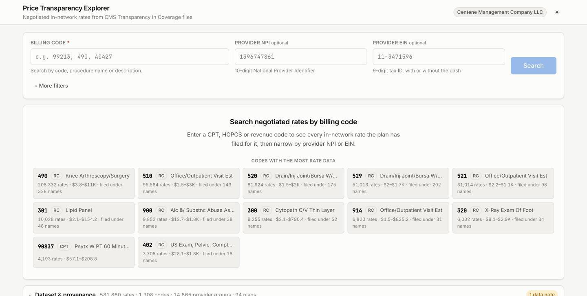
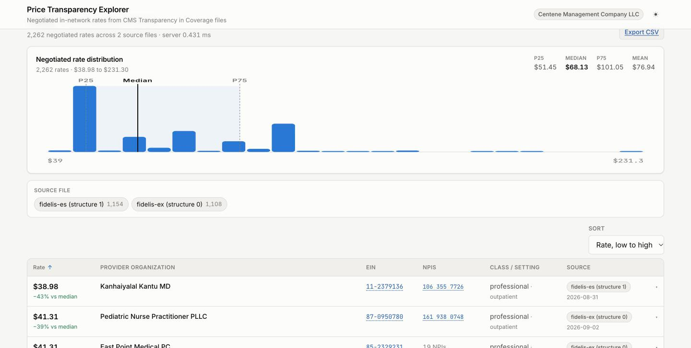
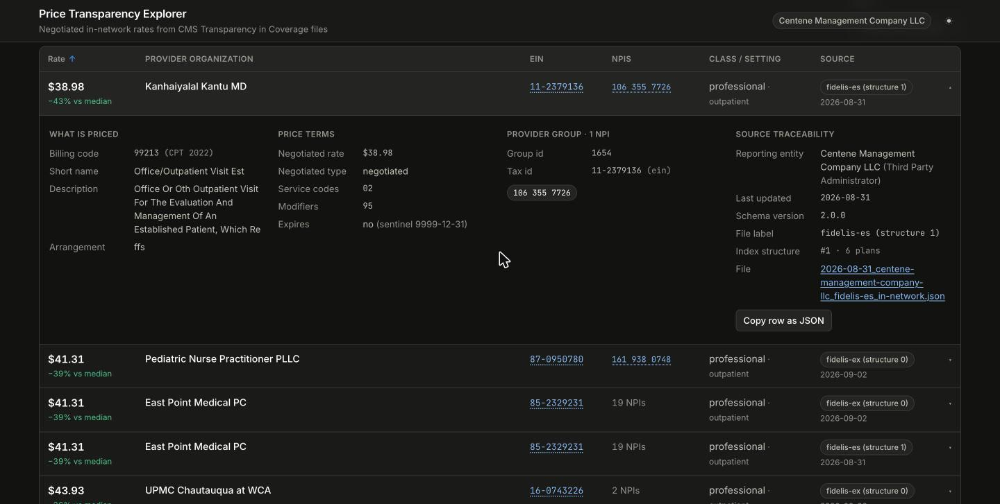
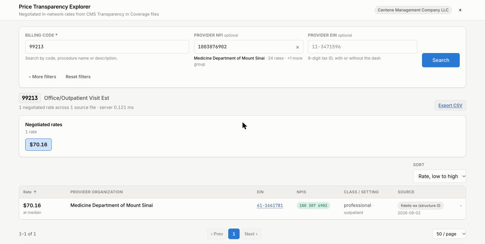
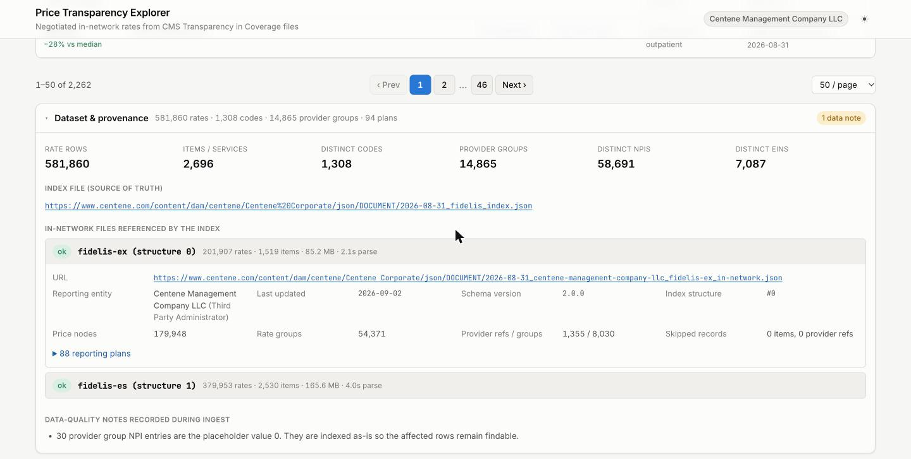

# Price Transparency Explorer

A full-stack tool for searching negotiated in-network rates out of CMS
**Transparency in Coverage** machine-readable files.

It starts from the Centene/Fidelis index file, follows it to the in-network rate
files it references, streams and normalizes them, and exposes a search API and a
UI where you can look up a billing code and narrow the results by provider NPI
or EIN.

**Stack:** Go 1.23 (standard library only) · Vue 3 + TypeScript + Vite



---

## Contents

- [Quick start](#quick-start)
- [What it does](#what-it-does)
- [Screenshots](#screenshots)
- [Architecture and data flow](#architecture-and-data-flow)
- [API](#api)
- [What the source data actually looks like](#what-the-source-data-actually-looks-like)
- [Design decisions and tradeoffs](#design-decisions-and-tradeoffs)
- [Error handling](#error-handling)
- [Verification](#verification)
- [Performance](#performance)
- [Testing](#testing)
- [Project layout](#project-layout)
- [What I would do with more time](#what-i-would-do-with-more-time)

---

## Quick start

**Requirements:** Go 1.23+ and Node 20+. Nothing else — the backend has zero
external Go dependencies.

```bash
git clone <this-repo> && cd price-transparency-explorer

# One process: builds the UI and serves everything from :8080
make run
# then open http://localhost:8080
```

Or run the two dev servers side by side with hot reload:

```bash
make dev            # backend :8080, Vite dev server :5173
# then open http://localhost:5173
```

Without `make`:

```bash
# terminal 1
cd backend && go run ./cmd/server

# terminal 2
cd frontend && npm install && npm run dev
```

### First run takes about 13 seconds

On startup the server reads the index file and ingests **both** in-network files
it references — 263 MB in total. The UI shows real progress while this happens
rather than an indefinite spinner. Downloaded files are cached in
`backend/.cache`, so every restart after the first takes about 6 seconds (parse
only). The cache is gitignored.

If you want to skip the wait while poking at the code:

```bash
make fast           # ingest only 200 items per file (~1s)
make offline        # use only what is already cached; never touch the network
```

### Useful flags

| Flag | Default | Purpose |
|---|---|---|
| `-addr` | `:8080` | listen address |
| `-index-url` | the Centene/Fidelis index | point at a different TiC index |
| `-cache-dir` | `.cache` | where raw source files are cached; empty disables caching |
| `-static-dir` | *(none)* | serve a built frontend from this directory |
| `-max-items` | `0` | cap `in_network` records per file (fast iteration) |
| `-max-files` | `0` | cap how many in-network files to ingest |
| `-offline` | `false` | serve only from the cache |
| `-allowed-origins` | `localhost:5173` | CORS origins for the API |

Every flag has a `PTE_`-prefixed environment variable equivalent
(`PTE_ADDR`, `PTE_INDEX_URL`, …).

> **If the index URL has rotated.** CMS files are republished monthly. If the
> default URL 404s, grab a current one from
> [centene.com/price-transparency-files.html](https://www.centene.com/price-transparency-files.html)
> and pass it with `-index-url`. The UI tells you this when ingest fails.

---

## What it does

1. **Reads the index as the source of truth.** It parses every
   `reporting_structure`, collects each `in_network_files` reference together
   with the plans that structure covers, and ingests all of them. Nothing about
   the rate file URLs is hardcoded.
2. **Streams and normalizes the rate files.** 263 MB of pretty-printed JSON is
   decoded incrementally and flattened to **581,860 searchable rate rows**.
3. **Resolves providers.** Every rate in these files points at a
   `provider_references` ID rather than carrying NPIs inline, so the rate and
   the provider identity have to be joined across two separate sections of the
   file.
4. **Serves a search API.** Billing code required; NPI, EIN and eight other
   parameters optional.
5. **Presents the results.** With a rate distribution, facets that respect each
   other, per-row provenance back to the filed document, and CSV export.

---

## Screenshots

**Search results** — rate distribution with quartile markers, facet chips, and
one row per provider organization.



**Row provenance** (dark mode) — every row expands to the full record: what is
priced, the price terms, the provider group and its NPIs, and the source file
it was filed in.



**Provider filtering** — the NPI resolves to its organization as you type, so a
typo is distinguishable from "this provider doesn't price this code". With one
result there is no distribution to plot, so the value is shown instead of a
one-bar histogram.



**Dataset and provenance** — the index URL used, every file ingested with its
parse statistics and skip counts, the plans covered, and the data-quality notes
recorded during ingest.



---

## Architecture and data flow

```
                 CMS index file  (30 KB, 2 reporting structures)
                          │
             tic.ParseIndex ──► targets: [{inNetworkURL, plans[]}]
                          │
          fetch.Fetcher   │  HTTP + on-disk cache + retry/backoff
          (downloads run concurrently; parsing is sequential)
                          │
             ┌────────────┴─────────────┐
             ▼                          ▼
   fidelis-ex (89 MB)          fidelis-es (174 MB)
             │                          │
       tic.StreamInNetwork — token-level json.Decoder, never holds the doc
             │                          │
   provider_references ──► ProviderGroup{gid, npis[], ein, business_name}
   in_network[]        ──► flatten item × rate group × price × provider group
             └────────────┬─────────────┘
                          ▼
                    store.Builder
          interning · enum ordinals · reference resolution
                          │
                          ▼
                  store.Store  (immutable, 581,860 rows)
         code      → []rowID        primary index, one map lookup
         npi       → []groupID      inverted
         ein       → []groupID      inverted
         plan_id   → []sourceID     inverted
                          │
                   GET /api/rates?code=…
                          │
                          ▼
              Vue 3 SPA (URL-synced search state)
```

**Package responsibilities.** Each one is independently testable with no
network:

| Package | Responsibility | Knows nothing about |
|---|---|---|
| `internal/tic` | CMS schema types, index parsing, streaming rate parsing, NPI/EIN normalization | HTTP, storage |
| `internal/fetch` | retrieving URLs, disk cache, retry | the CMS file format |
| `internal/store` | normalized data, indexes, query execution | I/O, HTTP |
| `internal/ingest` | orchestration, progress, failure isolation | query semantics |
| `internal/api` | request validation, response shaping | parsing, storage internals |

**The normalization grain.** One row is **one negotiated price for one provider
organization**. That is the grain the files express once `provider_references`
is resolved, and it is the grain a person can read: a single dollar amount
attached to a single organization with a single EIN. Flattening the live files
to that grain gives 581,860 rows, which fits in memory comfortably.

**Threading.** The store is built once and never mutated, so reads need no
locks. Ingest runs on a background goroutine and swaps the finished store in
atomically; readers never see a half-built dataset and never block behind
ingest. The whole thing is clean under `-race`.

---

## API

| Endpoint | Purpose |
|---|---|
| `GET /api/health` | liveness and ingest progress; always `200` so a cold start is not mistaken for a dead process |
| `GET /api/meta` | counts, source files with parse statistics, plans, facet domains, data-quality notes |
| `GET /api/codes?q=` | billing-code typeahead over code, name and description |
| `GET /api/providers?npi=&ein=&q=` | resolve an identifier or name fragment to provider groups |
| `GET /api/rates?code=` | **the search.** `code` required; everything else narrows |
| `GET /api/rates.csv?code=` | the full matched set as CSV |

### `/api/rates` parameters

`code` **(required)**, `code_type`, `npi`, `ein`, `billing_class`, `setting`,
`negotiated_type`, `plan_id`, `source`, `min_rate`, `max_rate`, `sort`
(`rate_asc` | `rate_desc` | `provider` | `npi_count`), `page`, `page_size`.

```bash
# every rate filed for a CPT office visit
curl 'localhost:8080/api/rates?code=99213&code_type=CPT'

# narrowed to one provider organization, dashed EIN accepted
curl 'localhost:8080/api/rates?code=99213&ein=61-1661781'

# narrowed to one clinician
curl 'localhost:8080/api/rates?code=99213&npi=1003076902'
```

Each result row is self-describing — it carries what is priced, the price terms,
the resolved provider group, and a `source` block naming the file, the reporting
entity, the schema version and the `last_updated_on` date. A row you export or
link to still says where it came from.

The response also carries `stats` (count, min, max, mean, median, p25, p75 and a
24-bucket histogram over the **whole** match, not the page), `facets`,
`pagination`, and a `query` echo showing exactly how the server interpreted your
input — including the normalized form of each identifier and any warnings about
it.

---

## What the source data actually looks like

I measured the files before designing anything. These numbers drove most of the
decisions below.

| | fidelis-ex | fidelis-es |
|---|---|---|
| File size | 89 MB | 174 MB |
| `in_network` items | 1,519 | 2,530 |
| Distinct billing codes | 802 | 1,221 |
| `negotiated_rates` groups | 54,371 | 91,742 |
| `negotiated_prices` nodes | 179,948 | 359,853 |
| `provider_references` entries | 1,355 | 1,908 |
| Provider groups | 8,030 | 6,835 |
| Distinct NPIs | 43,834 | 47,129 |
| Reporting plans | 88 | 6 |

Combined: **581,860 rate rows**, 1,308 distinct codes, 14,865 provider groups,
58,691 NPIs, 7,087 EINs, 94 plans.

Rows per code are extremely skewed — median **5**, p90 **106**, mean **445**,
max **208,332**. Most codes are tiny; a handful dominate. That shape is what
makes a simple code index plus a linear scan the right call, and it is also
what makes the worst case worth measuring separately.

### Things worth knowing about these files

1. **Providers are never inline.** All 146,113 rate groups use
   `provider_references`; none use inline `provider_groups`. Rate and provider
   identity live in different sections and must be joined by ID. (The parser
   handles inline groups anyway, since the schema permits them.)
2. **Each rate group references exactly one provider reference.** That is what
   makes full flattening cheap — 581,860 rows rather than millions.
3. **A billing code is not a unique key.** The same number appears under
   different `billing_code_type`: `490` is both a revenue code and a CPT code.
   Searching by code alone returns both; `code_type` disambiguates.
4. **Revenue code 490 is filed under 328 different procedure names**, every one
   carrying the identical rate ladder ($3.76–$10,955.28), for 208,332 rows on
   one code. Summarizing codes per item name made typeahead return "490" ten
   times in a row, so code summaries aggregate per (code, code type) and report
   a `name_count` instead.
5. **NPI `0` appears 30 times** as a placeholder, and one NPI (`124507857`) is
   nine digits — a leading zero lost to JSON number typing. Of 43,834 distinct
   NPIs in fidelis-ex, 43,832 pass the CMS check-digit test. These are reported
   as data-quality notes and remain searchable.
6. **EINs are dash-formatted** (`11-3471596`) and indexed digits-only, so either
   spelling works.
7. **`expiration_date` is the sentinel `9999-12-31` throughout** — the UI reads
   that as "does not expire" rather than showing a date in the year 9999.
8. **`setting` and `negotiated_type` have exactly one value each** across the
   whole dataset (`outpatient`, `negotiated`), so the UI hides those filter
   controls. A control that cannot narrow anything is noise.
9. **Both files share the description "in-network file"** in the index, so the
   description alone cannot label a source filter. Sources get a derived unique
   label (`fidelis-ex (structure 0)`).

---

## Design decisions and tradeoffs

### Go standard library only, no dependencies

`encoding/json`'s token-level decoder streams a 174 MB document without
materializing it, and Go 1.22's `net/http` router handles method-and-path
patterns. Adding a router or a JSON library would have bought nothing and cost
the reviewer a dependency tree.

### Stream, don't load

The naive approach — `json.Unmarshal` the whole file — needs well over a
gigabyte for these two files and scales with file size rather than with the data
you keep. The parser walks top-level keys and decodes array elements one at a
time, so peak memory is governed by the normalized output, not the input.

**The tradeoff I made inside that:** each array element is read into a
`json.RawMessage` *before* unmarshaling into its struct. That is one extra copy
per record. It buys per-record error isolation — a record with an unexpected
shape is counted and skipped while the stream continues, whereas decoding
straight into the struct leaves the decoder's position unreliable after a type
error. For files this size, resilience is worth the copy.

### Flatten eagerly, index narrowly

Rows are flattened at ingest and indexed by billing code; every other filter is
a linear scan over that code's rows. The rows-per-code distribution is heavily
skewed — **median 5, p90 106, mean 445, max 208,332** — so for almost every
query the scan is a few microseconds. That buys the ability to skip maintaining
a separate index per filterable field on a dataset that is rebuilt from scratch
on every boot.

**Where that bites:** the tail. Revenue code 490 matches 208,332 rows, and
scanning, sorting and summarizing them takes ~67 ms — three orders of magnitude
slower than the median query. See [Performance](#performance).

### Facets exclude their own filter

Each facet's counts are computed with every filter applied *except* its own, by
counting how many predicates each row fails in a single pass. Selecting
"institutional" therefore does not drop the "professional" count to zero and
hide the option. This is the behavior that makes facets usable, and it is easy
to get subtly wrong.

### Identifier problems are warnings, not rejections

An NPI that fails its check digit, or has nine digits, is still *in the data*.
A tool that refuses to look it up cannot be used to investigate the data-quality
problem it just surfaced. So malformed identifiers are normalized, searched, and
reported with a warning. Only input with no digits at all is a `400`.

### NPI and EIN intersect

Supplying both requires a provider group to satisfy *both*. The union would
produce rows contradicting at least one of the user's constraints.

### Statistics are returned unrounded

Rounding in the API would bake in a tie-breaking rule — Go rounds halves away
from zero, other runtimes round to even — and silently disagree with anyone
recomputing from the raw files. Formatting is the frontend's job. (I found this
by cross-checking against Python and seeing 254.95 vs 254.94.)

### Search state lives in the URL

Every result is shareable and reloadable, and the back button behaves the way it
should in a search tool.

### Accepted limitations

- **In-memory only.** Per the brief. Restarting re-ingests. Nothing persists
  except the raw-file cache.
- **One payer.** The index URL is a flag, but the UI assumes a single dataset.
- **Allowed-amount files are ignored.** The index references them; out-of-network
  allowed amounts are a different schema and a different question.
- **No `bundled_codes` handling.** Every record in these files is `ffs`. The
  field is parsed and retained but not searchable.
- **Plan filtering is coarse.** The index files one set of rates per *reporting
  structure*, not per plan, so plans sharing a file share its rates. Filtering by
  plan narrows to the covering files — which is as precise as the source data
  allows. The UI says so.
- **CSV export caps at 50,000 rows.** Reachable on code 490, so it is reported
  in the response headers *and* as a trailing row in the file rather than
  truncating silently.

---

## Error handling

Failures are isolated to the smallest unit that makes sense, and never crash the
app:

| Failure | Behavior |
|---|---|
| Index unreachable or unparseable | Fatal to ingest (there is nothing to ingest without it). Server stays up; UI shows the error with a link to current CMS files. |
| One rate file 404s or is corrupt | That source is marked `failed` with its reason. Remaining sources still serve. Visible in `/api/meta` and the provenance panel. |
| Malformed record inside a file | Counted in `skipped_items` / `skipped_provider_refs`; the stream continues. Counts are surfaced in the UI. |
| Non-standard top-level key | Recorded in `unknown_top_level_keys`, not fatal. |
| Dangling `provider_references` ID | The **rate is kept** with the provider marked `unresolved`. Dropping it would silently lose real pricing. |
| Interrupted download | Streamed to a temp file and renamed on success, so a partial file is never mistaken for a complete one; retried with backoff. |
| Request before ingest finishes | `503` with `Retry-After`; the UI polls `/api/health` and shows progress. |
| Invalid query parameter | `400` naming the field, with a recovery hint. |
| Unknown billing code | `200` with an empty result **and suggestions** — a valid question with no answer is not an error. |
| Anything unanticipated | A recover middleware turns a panic into a JSON `500`. |

---

## Verification

Beyond unit tests, `scripts/crosscheck.py` rebuilds the expected dataset in
Python **directly from the raw CMS files** and compares it against the running
API. It shares no code with the Go implementation, so it catches logic errors
that a test written alongside the code would not.

```bash
make backend          # in one terminal, wait for "ready"
make verify           # in another
```

It checks dataset totals, per-code totals and all six rate statistics plus
histogram conservation, NPI filtering, EIN filtering in both spellings,
NPI∩EIN intersection, `billing_class` partitioning, a full paginated walk of the
largest code (208,332 rows across 417 pages, comparing the summed rates), and
sort ordering.

```
ALL 522 CROSS-CHECKS PASSED
```

(`--codes` and `--providers` control the sample size; `--quick` skips the
pagination walk. The run above takes about 35 seconds against a warm cache.)

This is also how I found two real bugs: the statistics rounding described above,
and a CSV export that truncated silently at 50,000 rows.

---

## Performance

Measured on an M-series laptop against the live files.

| | |
|---|---|
| Cold start (download 263 MB + parse + index) | **13.4 s** |
| Warm start (cached files, parse + index) | **6.1 s** |
| Resident memory, fully ingested | **~420 MB** |
| Typical query (2,262 rows) | **0.3 ms** |
| Small query (2 rows) | **0.02 ms** |
| Worst case (code 490, 208,332 rows) | **67 ms** |
| 200 requests at 20-way concurrency on the worst case | p50 439 ms, p95 654 ms |

The worst case started at 202 ms. Three changes brought it to 67:

1. Facets were five separate passes with map writes per row. Faceted dimensions
   now carry `uint8` ordinals assigned at build time, so one pass over the
   candidates produces all five facets as slice increments.
2. `sort.SliceStable` became `slices.SortFunc` (pdqsort) with an explicit
   tiebreak on row ordinal — deterministic ordering across pages without paying
   for stability.
3. When results are sorted by rate, the statistics reuse that ordering instead
   of sorting a second quarter-million-element slice.

---

## Testing

```bash
make test        # Go tests + frontend typecheck
make test-race   # race detector
make cover       # coverage summary
```

**82.8% statement coverage**, clean under `-race`, and **no test reaches the
internet** — fixtures are trimmed from the live files and served from loopback
`httptest` servers or read from the local filesystem, so the suite runs offline
and deterministically.

What the tests actually pin down, beyond happy paths:

- Streaming parse with malformed records, inline provider groups, dangling
  references, non-standard keys, and scalar-vs-array coercion
- NPI check digit against the CMS published example; malformed identifiers stay
  searchable
- Flattening arithmetic, including the multi-TIN fan-out
- NPI∩EIN intersection returning empty rather than the union
- Facets summing to the unfiltered total under their own filter
- Percentile interpolation and histogram conservation at the maximum value
- Pagination partitioning the result set; pages past the end return empty
- Per-source ingest failure isolation; total failure reported as failure
- Offline mode never touching the network
- `Status()` returning a copy rather than aliasing internal state
- API validation, `503` before ingest, JSON 404s, panic recovery, CORS

`backend/testdata/in-network.malformed.json` is a deliberately hostile fixture
covering the failure modes above.

---

## Project layout

```
backend/
  cmd/server/            entry point, flags, graceful shutdown
  internal/tic/          CMS schema: index parse, streaming rate parse, identifiers
  internal/fetch/        HTTP + disk cache + retry
  internal/store/        normalized data, indexes, search, facets, statistics
  internal/ingest/       orchestration, progress, failure isolation
  internal/api/          handlers, validation, routing, middleware
  testdata/              trimmed real fixtures + a malformed one
frontend/
  src/api/               typed client and response shapes
  src/composables/       ingest gate, search lifecycle, URL state, formatting
  src/components/        search form, typeahead, chart, table, facets, provenance
scripts/crosscheck.py    independent verification against the raw files
docs/                    design spec and screenshots
```

---

## What I would do with more time

**Storage.** The obvious next step is getting off "rebuild everything on every
boot". DuckDB or Parquet over the flattened rows would give persistence,
out-of-core queries, and SQL for the aggregate questions this shape of data
invites — without the operational weight of Postgres. The normalization step
already produces exactly the columnar shape that wants.

**Incremental ingest.** The index carries `last_updated_on` per file. Comparing
it against what is already cached would make restarts near-instant and make a
scheduled refresh cheap. Byte-range requests could fetch only a changed tail.

**The 67 ms worst case.** A page of 50 rows out of 208,332 does not need a full
sort. Quickselect to partition around the requested page, then sort only that
page, would make it roughly linear.

**Rate benchmarking.** The genuinely useful question is not "what is this rate"
but "how does it compare" — to Medicare, to the market median for that code in
that geography, to the same provider's other contracts. That needs a reference
price set joined per code and region. It is also the thing Serif actually sells,
so I would want to understand the real shape of that before guessing.

**Provider enrichment.** Joining NPIs against the NPPES registry would give
specialty, address and geography, which turns "who charges this" into "what does
this cost near me" and enables geographic filtering.

**Multi-payer.** Ingesting several payers' indexes concurrently and comparing the
same code across them is the natural extension, and the main thing the current
single-dataset UI assumption would need to change for.

**Frontend tests.** The backend is well covered; the frontend is covered only by
a typecheck. Vitest for the composables, especially URL state round-tripping and
the search request lifecycle, and Playwright for the cold-start gate.

**Operational.** Structured logging, Prometheus metrics on ingest duration and
query latency, and a `/readyz` separate from `/healthz` so a load balancer can
tell "starting" from "broken".

---

## Notes on process

I used AI assistance while building this. The parts I would point at as the
substance of the work: measuring the source files before designing anything
(which is where the provider-reference indirection, the 328-name revenue code,
and the placeholder NPIs came from), choosing the flattening grain, the facet
semantics, the decision to treat identifier problems as warnings, and writing an
independent Python implementation to cross-check the Go one — which is what
caught the rounding and CSV truncation bugs.

The design spec written before implementation is in
[`docs/superpowers/specs/`](docs/superpowers/specs/).
